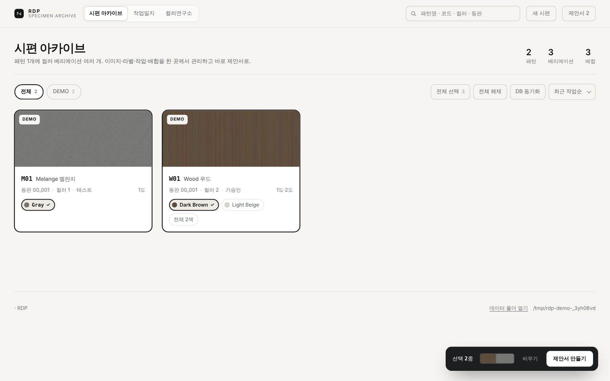
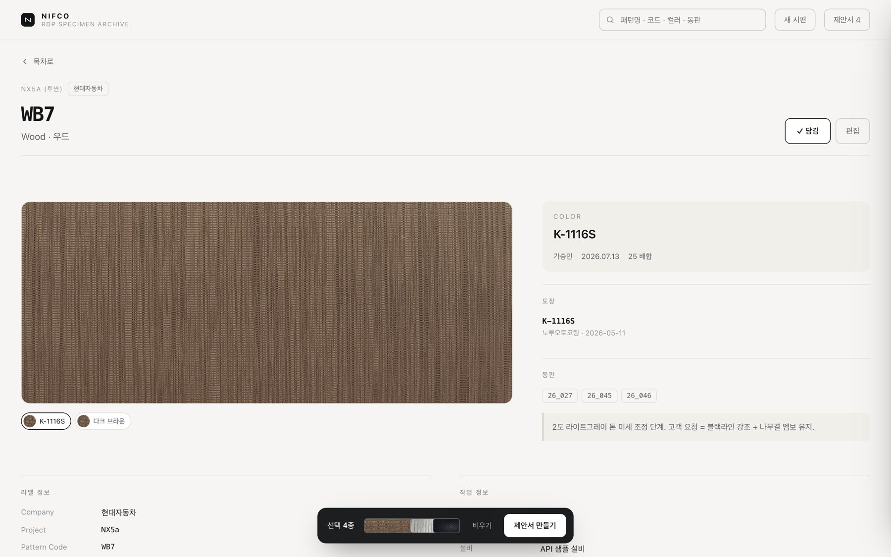
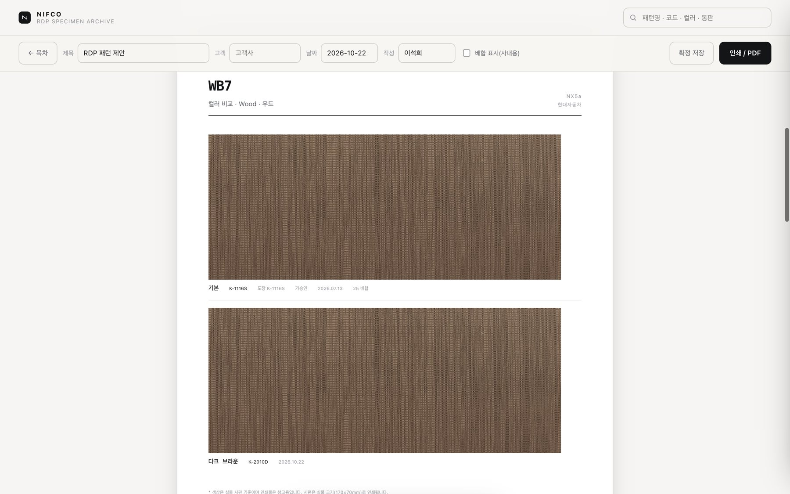

# RDP Specimen Archive





패턴 시편(스와치)을 쇼핑몰처럼 훑고, 원하는 컬러만 담아 **A4 제안서 PDF**로 뽑는 개인용 로컬 앱.
서버·DB 설치 없이 맥에서 더블클릭으로 실행하고, 데이터는 구글 드라이브 동기화 폴더에 JSON + 이미지로 저장한다.

```
로컬 Python 서버 (127.0.0.1:8791)
   ↕ 읽기/쓰기
구글 드라이브/RDP-Archive/
   patterns/<패턴ID>.json      패턴 1건 = 파일 1개
   images/<패턴ID>/<변형ID>[-n].jpg   170:70, 2400×988
   _orig/<패턴ID>/...          업로드 원본 보관
   _backup/<패턴ID>.<시각>.json  저장 전 스냅샷
   _trash/                     삭제 대신 이동
   proposals/<날짜>_<고객>/proposal.json  확정 스냅샷
   _ui/state.json              장바구니·제안서 설정 (포트가 바뀌어도 유지)
```

## 왜 이 구조인가

| 후보 | 판정 |
|---|---|
| Google Apps Script Web App | 오프라인 불가, base64 업로드 느림, 웹앱 URL만 알면 누구나 쓰기 가능 |
| Google Sheets를 DB로 | `mixes[]` 같은 중첩 구조와 맞지 않음, 사람이 셀을 고치면 형식이 깨짐 |
| **로컬 Python + 드라이브 폴더** | 오프라인 가능, raw PUT 업로드, 외부 노출 없음 → **채택** |

리스크 대응:
- **드라이브 스트리밍 모드**면 오프라인에서 이미지가 안 열린다 → 아카이브 폴더를 "오프라인 사용 가능"으로 설정.
- **동기화 중 반쯤 쓰인 JSON**을 막기 위해 임시 파일 + `os.replace` 원자적 쓰기.
- **SQLite는 드라이브에 두지 않는다** (저널 파일과 동기화가 섞이면 깨짐). 이 앱은 JSON만 쓴다.
- **패턴별 파일 분리** → 충돌 시 피해가 1건으로 한정되고, 드라이브 버전 기록도 패턴 단위로 남는다.

## 데이터 모델 (v2)

필드 소유권을 스키마에서 고정한다. 상속/오버라이드 병합 로직이 없다.

- **패턴 레벨**: `project`, `pattern{code,name,nameKo,tags}`, `label{item,type,supplier,remark}`, `work{place,worker,machine,plate[],emboss,pad,sop,volume}`, `history[]`
- **베리에이션 레벨**: `id`(불변), `colorName`, `colorCode`, `coating[]`, `status`, `date`, `images[]`, `mixes[]`, `note`
- **파생값은 저장하지 않는다** (`stats`, `layers` 등은 렌더 시 계산)
- `result`는 enum(`ok`/`warn`/`ng`/`plan`/`""`), 아이콘은 화면에서 붙인다
- `isReference` = 그 층(1도/2도)의 대표 배합. 층마다 1개만 허용하고 서버가 경고한다

```jsonc
{
  "schemaVersion": 2,
  "id": "DEMO-W01",
  "project": "DEMO", "projectName": "DEMO (샘플 차종)", "client": "Sample Motors",
  "pattern": { "code": "W01", "name": "Wood", "nameKo": "우드", "tags": ["우드"] },
  "label":   { "item": "도어 가니시", "type": "2도 인쇄", "supplier": "Sample Supplier" },
  "work":    { "place": "Sample Plant", "plate": ["00_001"], "emboss": "HT-77D", "sop": "2027-01" },
  "variations": [
    { "id": "v01", "colorName": "Dark Brown", "colorCode": "C-1001",
      "coating": [{ "maker": "Sample Coating", "code": "C-1001", "lot": "2026-01-05" }],
      "status": "가승인", "date": "2026-01-20", "images": ["v01.jpg"],
      "mixes": [{ "layer": "1도", "batch": "1", "inks": { "MT": 30, "BK": 30 },
                  "mattingPct": 2, "thinnerPct": 30, "hardenerPct": 20,
                  "result": "ok", "isReference": true }] }
  ]
}
```

## 실행

```bash
python3 -m pip install --user pillow      # 최초 1회
python3 server.py                         # http://localhost:8791
```

`RDP Archive.command` 를 더블클릭하면 같은 일을 한다 (macOS).

`config.json`:

```json
{
  "dataRoot": "/Users/<you>/Library/CloudStorage/GoogleDrive-.../내 드라이브/RDP-Archive",
  "port": 8791,
  "brand": "RDP",
  "brandSub": "SPECIMEN ARCHIVE",
  "company": "COMPANY · TEAM"
}
```

데모 데이터로 바로 둘러보려면:

```bash
python3 server.py --demo    # sample-data 를 임시 폴더에 복사해 실행 (구현 예정)
```

## API

| Method | Path | 설명 |
|---|---|---|
| GET | `/api/patterns` | 전체 패턴 JSON |
| PUT | `/api/patterns/<id>` | 저장 (검증 → `_backup` → 원자적 쓰기) |
| DELETE | `/api/patterns/<id>` | `_trash`로 이동 |
| PUT | `/api/image/<pid>/<vid>?slot=1&x=..&y=..&w=..&h=..` | 원본 바이트 + 크롭 좌표 → 2400×988 JPEG (파일명은 `v01-1-<시각>.jpg`처럼 매번 새로 생성) |
| DELETE | `/api/image/<pid>/<filename>` | `_trash`로 이동 |
| POST | `/api/proposals` | 제안서 스냅샷 저장 (참조 이미지를 `proposals/<slug>/images/`로 함께 복사) |
| GET/PUT | `/api/ui` | 장바구니·제안서 설정(제목/고객/코멘트) 서버 보관 |
| GET | `/api/rdp/status` | rdp.db 연결 상태와 패턴별 배합 수 |
| POST | `/api/rdp/sync/<id>` | 그 시편의 배합을 rdp.db에서 가져와 병합 |
| POST | `/api/rdp/sync-all` | 전체 시편 일괄 병합 |
| GET | `/api/rdp/diff/<id>` | 아카이브와 DB의 차이만 계산 (쓰기 없음) |
| GET | `/api/plate/<lot>` | 동판 정보(크기·종류·비고)와 그 동판을 쓰는 패턴 목록 |
| GET | `/api/rdp/push-preview/<id>` | DB로 보낼 변경 계획 (수정/신규/건너뜀, 쓰기 없음) |
| POST | `/api/rdp/push/<id>` | 계획대로 rdp.db에 UPDATE/INSERT (DB 파일 백업 후 트랜잭션) |

저장 요청에는 `X-Base-Rev: <updatedAt>` 헤더를 함께 보낸다. 서버의 현재 값과 다르면 **409 + 최신 문서**를 돌려주고, 화면은 "다른 곳에서 먼저 저장되었습니다"를 띄운 뒤 최신 내용을 불러올지 묻는다. 패턴 단위 `threading.Lock`으로 같은 파일 동시 쓰기도 막는다.

업로드는 **raw PUT**(`Content-Type: application/octet-stream`)이다. multipart 파싱이 필요 없어 표준 라이브러리만으로 충분하다.
HEIC는 Pillow가 못 열면 `sips`로 변환한다.

## 화면

1. **목차** — 패턴 카드 + 컬러 칩. 칩을 누르면 카드 이미지가 그 컬러로 바뀌고, 체크하면 그 컬러가 담긴다.
   `새 시편`을 누르면 **상세 페이지와 같은 화면**이 빈 값으로 열리고, 값을 채운 뒤 `저장`하면 그 ID로 생성되어 같은 화면으로 이어진다.
2. **상세** — 이미지 / 컬러 카드 / 라벨 / 작업 / 배합표 / 작업일지. **값을 클릭하면 그 자리에서 바로 수정**되고(컬러명·컬러코드·상태·날짜·동판·메모·라벨·작업 필드), Enter 또는 바깥 클릭으로 저장된다. 배합표·이미지·베리에이션 구조는 `편집` 드로어에서 다룬다. 상단 `← 목차`로 언제든 목록으로 돌아간다.
3. **제안서** — 표지 + 패턴별 페이지. 각 페이지는 **PATTERN · COLOR · ITEM · TYPE · REMARK** 다섯 항목만 인쇄한다. REMARK는 `동판 · 대표 배합코드`(예: `26_027 · 1도-28 / 2도-AH`)로 자동 생성된다. 문서번호(`RDP-P-YYYYMMDD-01 Rev.0`)가 표지와 푸터에 들어간다. 같은 패턴에서 컬러를 2개 이상 고르면 **170×70mm 실물 크기로 세로 스택**해 비교한다.

### 인쇄 규격

- A4 세로, 여백 0, **배율 100%**(기본값), **배경 그래픽 켬**
- 이미지는 170×70mm = 실물 시편 크기. **한 장에 2개**까지 (`firstPageMax`, `pageMax`).
  3개를 넣으면 실측 312mm로 A4 인쇄 영역(270mm)을 넘는다. 3/3으로 바꾸려면 상단 여백과 캡션을 줄여야 한다.
- 4개를 3+1로 나누면 마지막 장이 비므로 `ceil(n/3)` 후 균등 분배한다 (4 → 2+2, 5 → 3+2).
- 페이지 상한은 `config.json`의 `firstPageMax` / `pageMax`로 조정한다 (기본 2/2).
- 페이지마다 "색상은 실물 시편 기준, 인쇄물은 참고용" 문구가 들어간다.
- 푸터에 **30mm 실측 눈금**이 있어 인쇄 후 자로 바로 검증할 수 있다 (배율이 틀어졌는지 확인용).

## 편집

- 우측 드로어 탭: 기본 / 베리에이션 / 배합 / 이미지 / JSON
- **이미지**: 업로드 시 170:70 크롭 UI(드래그·줌) → 서버에서 2400×988 JPEG q85 저장, 원본은 `_orig`
- **베리에이션**: 추가·복제·삭제. 배합표에서 체크한 행을 **다른 베리에이션으로 이동**할 수 있다
- **도수별 동판**: 동판은 배합 행이 아니라 **도수(층)에 한 번만** 지정한다. `1도 [26_037] 2도 [26_044]`처럼 층마다 다른 동판을 쓸 수 있고, 그 층의 모든 배합이 따라간다. 읽기 화면에서는 층 제목의 동판 칩을 눌러 바로 바꾼다
- **도수 추가**: 배합 탭의 `+ 도수 추가`로 3도 같은 새 층을 만들고 그 층의 배합을 넣는다
- **동판 링크**: 읽기 화면의 동판 번호를 누르면 크기·종류·비고와 그 동판을 쓰는 패턴 목록이 뜬다
- **저장**: 명시적 저장 버튼. 서버가 스키마 검증 → `_backup` → 원자적 쓰기
- **삭제**: `_trash`로 이동 (복구 가능)
- **업로드는 항상 새 파일명**으로 저장한다. 저장을 누르기 전에 업로드만 하고 닫아도 원본을 덮어쓰지 않으며, 참조되지 않는 파일은 다음 저장(또는 서버 시작) 때 `_trash`로 정리된다
- **저장하지 않은 변경**이 있으면 드로어를 닫을 때 확인을 받는다

## RDP-DB 배합 연동

`config.json`의 `rdpDbPath`가 가리키는 SQLite(기본 `~/MySecondBrain/Areas/NIFCO/RDP-DB/rdp.db`)를 **읽기 전용**으로 열어 배합만 가져온다.

- 병합 키는 `(layer, batch_no)`이고, **같은 배치번호가 동판별로 여러 개면 동판까지 본다**(예: `1도-H`가 26_040과 26_042에 각각 존재). 같은 배합이 있으면 잉크/비율/결과/날짜를 DB 값으로 갱신하고, 없으면 추가한다.
- **메모(`note`)와 기준 배합 표시는 건드리지 않는다.** 앱에서 적은 코멘트가 날아가지 않는다.
- **삭제는 하지 않는다.** DB에서 사라진 배합도 아카이브에는 남는다.
- 베리에이션이 여러 개면 DB의 `coating_code`와 `colorCode`가 같은 베리에이션에 넣고, 없으면 첫 번째에 넣는다.
- 화면: 상세 → 편집 → 배합 탭의 `RDP-DB에서 가져오기`, 또는 목차 툴바의 `DB 동기화`(전체).

### 반대 방향 (아카이브 → DB)

`DB로 보내기`는 **명시적으로 눌렀을 때만** 동작한다.

1. `push-preview`로 무엇이 바뀌는지 먼저 보여준다 (예: `1도-28 · MT 30 → 33`).
2. `DB에 반영`을 누르면 **rdp.db를 `_backup/rdp.db.<시각>`으로 복사한 뒤** `BEGIN IMMEDIATE` 트랜잭션으로 UPDATE/INSERT 한다. 실패하면 롤백.
3. 동판이 없는 배합은 건너뛴다(어느 행인지 특정할 수 없음). 신규 배치번호는 INSERT.
4. 결과값은 enum(`ok`/`warn`/`ng`/`plan`)을 DB 표기(`✅`/`⚠️`/`❌`/`테스트예정`)로 되돌려 쓴다.
5. `DB에서 가져오기`와 **같은 파일을 양쪽에서 동시에 만질 수 있으므로**, 작업일지 쪽에서 DB를 쓰는 중이면 먼저 끝내고 누르는 게 안전하다.

## 제안서 스냅샷

`확정 저장`을 누르면 선택한 패턴/컬러/코멘트와 **이미지 파일까지** `proposals/<날짜>_<고객>/`에 복사하고 문서번호를 다음 번호로 넘긴다.
나중에 원본 배합을 고쳐도 **보낸 제안서의 내용은 바뀌지 않는다.**

## 라이선스

개인용 도구. 외부 배포 전 `config.json`의 브랜드/데이터 경로를 확인할 것.
